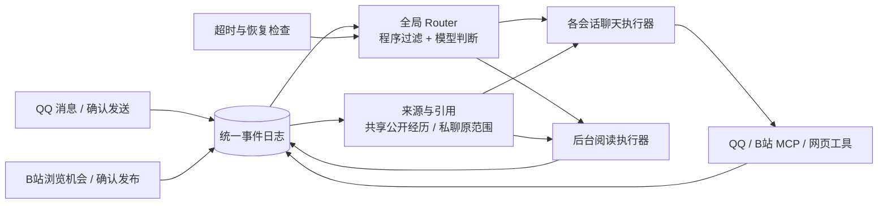

# 筷子 · Chopsticks

让大肥鱼更方便地“吃白饭”。基于 DSH 的持续在线、事件驱动角色运行时。

这是从实际养鱼需求重新组织的独立项目。保留 QQ 聊天、人设和记忆、B站阅读与受控互动、后台阅读任务；不安装 SurfCore，不依赖 SessionCross。



## 当前能力

- 同一条鱼的群聊与公开 B站经历共享。自己的发送必须取得平台回执才成为事实；回复前刷新上下文，发送时发现新事实会要求重新判断。
- 常驻的是逻辑 Router 和持久状态。模型评估使用独立短会话，避免无限增长及私聊上下文混入公共会话；多个执行器可并行处理。
- 后台任务使用 DeepSeek Super Agent prototype 的 MIT 事件/任务核心及窄 DSH 适配。结果入事件日志后回到来源会话。并非完整照搬官方产品或社区 fork；目前没有通用 MSP 和自动经验优化器。
- QQ 确认发送、引用、图片、合并转发、潜水、已读水位、记忆检索和追加；纯文字输出不会自动发到群里。
- 九个 B站 MCP 工具：元数据、搜索、字幕、评论读取、动态读取、观看历史、真实抽帧、受控评论和动态发布。
- 独立网页搜索/读取 MCP；受控网络访问和凭据脱敏。
- SQLite 保存事件、发送意图、任务和轻量记忆。不确定发送不会自动重试；停机恢复不会凭空声称操作成功。
- DSH **设置 → 筷子** 提供运行概览、事件链路、模型思考与工具追踪、运行日志；支持来源筛选和脱敏 JSONL 导出。见 [控制台说明](docs/console.md)。
- 启用管理员开发后，可在 QQ 用自然语言下达机器操作：接待会话核验真实管理员来源，再派独立开发 Worker 执行服务器命令、验证并回传结果。普通成员、B站资料与后台阅读任务不具备命令权限。见 [管理员开发](docs/admin-development.md)。

## 有意精简

首版省去旧产品的庞大设置页、桌宠/安装器/自更新器、语音栈、黑话学习器、自动表情收藏、拍一拍、旧主动问候和复杂仿真节奏。旧表情及角色数据仍在备份，但没有假装提供这些工具。QQ 接待会话保持社交与资料工具，管理员开发/自我迭代由独立、可追踪的授权任务执行。

SessionCross 保留为未来跨机器调度插件的基础，与本项目解耦。私聊按来源隔离，已授权群之间共享公开经历。

## 运行

需要 Node 24、DSH 0.2.1-rc.2、已登录的 SnowLuma OneBot HTTP/WebSocket。抽帧需要 ffmpeg。默认模型为 DeepSeek（`deepseek-official / deepseek-flash`），模型由 DSH provider 提供，服务器无需 GPU。修改运行配置后，已接入会话与恢复的后台任务都会同步模型选择，历史保持不变。

```sh
npm ci --ignore-scripts
npm test
CHOPSTICKS_FISH_HOME=/var/lib/chopsticks/fish node bili/mcp/server.mjs
CHOPSTICKS_CONFIG=/var/lib/chopsticks/config.json node web/server.mjs
```

DSH profile 将本包加入 `dependencies` 和 `dsh.profile.bundles`，由 `presets/runtime.patch.yml` 注册宿主及角色预设。配置、凭据、角色、SQLite 与真实聊天日志全部放源码目录之外。参考 [部署说明](docs/deployment.md) 和 [配置示例](config.example.json)。

日常开发与候选清单统一使用 `/root/workspace/dsh`，具体目录和两个调研日程见 [工作区说明](docs/workspace.md)。

## 实现与验收

[事件与 Router](core/README.md) · [B站接口](bili/README.md) · [网页接口](web/README.md) · [设计](docs/design.md) · [来源](NOTICE.md)

测试覆盖持久去重、未知结果恢复、跨群新事实、私聊隔离、并发取消、后台任务、账号/目标校验以及真实 MCP stdio。模型验收使用隔离传输，不向真实 QQ 或 B站发布测试内容。具体部署结果记录在 `docs/deployment.md`。
