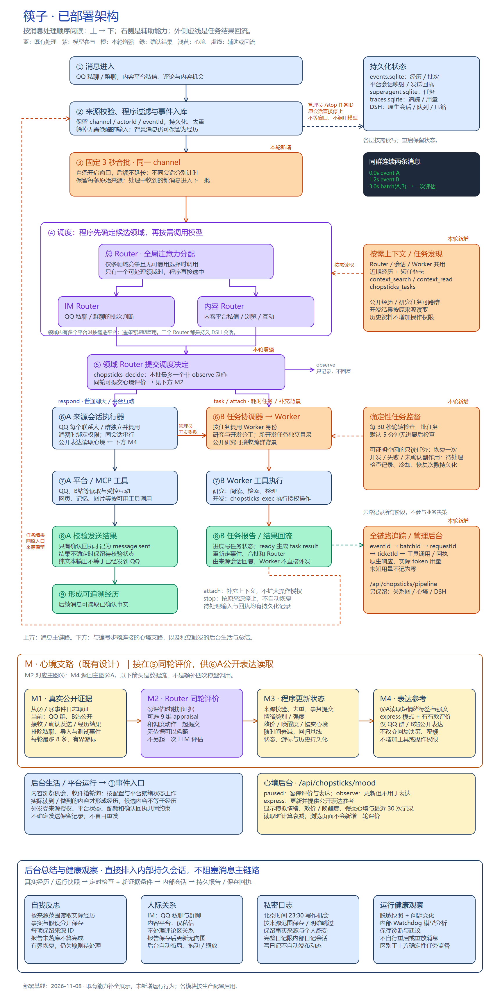

# 筷子 · Chopsticks

让大肥鱼更方便地“吃白饭”。基于 DSH 的持续在线、事件驱动角色运行时。

项目自有代码使用 TypeScript，构建为 Node 24 ESM；源码在 `src/`，部署产物在 `dist/release/`。[文档导航](docs/README.md) · [开发与构建](docs/development.md)

这是从实际养鱼需求重新组织的独立项目。保留 QQ 聊天、人设和记忆、B站阅读与受控互动、后台阅读任务；不安装 SurfCore，不依赖 SessionCross。

项目主许可为 [GPL-3.0-only](LICENSE)，与 MaiBot 的 GPLv3 生态对齐。第三方代码保留各自的许可证和署名；此前已按 MIT 发布的代码保留原授权。详见 [来源与许可说明](NOTICE.md)。

## 已部署架构

[按消息处理顺序查看完整架构](docs/architecture/overview.md) · [矢量图](docs/diagrams/chopsticks-deployed.svg) · [可编辑图源](docs/diagrams/chopsticks-deployed.excalidraw)



消息进入 → 程序过滤与入库 → 同会话固定 3 秒合批 → 按需选择领域 / 平台 → 准备消息与心境证据 → Router 同轮评估 → 调度决定与心境状态事务提交 → 来源会话读取心境表达 / 任务 Worker 执行 → 工具与确认回执。Worker 结果重新入队，再由来源会话回复。

心境在 Router 同轮评估中更新，供公开会话表达读取；图中同时列出后台生活、自我反思、人际关系、私密日志和运行健康观察的触发与保存方式。


## 当前能力

- 同一条鱼的群聊与公开 B站经历共享。自己的发送必须取得平台回执才成为事实；回复前刷新上下文，发送时发现新事实会要求重新判断。
- Router 工作区包含总体、IM、内容三个持久 DSH 会话；平台执行会话独立，使用 DSH 压缩和持久队列，多个执行器可并行处理。
- 后台任务使用 DeepSeek Super Agent prototype 的 MIT 事件/任务核心及窄 DSH 适配。结果入事件日志后回到来源会话。并非完整照搬官方产品或社区 fork；目前没有通用 MSP 和自动经验优化器。
- QQ 确认发送、引用、图片、合并转发、潜水、已读水位、记忆检索和追加；纯文字输出不会自动发到群里。
- QQ 媒体可读性：图片段可用 `chopsticks_image` 按 messageId 取回；视频、语音、卡片、合并转发当前只给带类型/时长/大小/id 的占位标记（如 `[视频:12s:1KB]`、`[合并转发:abc123]`），正文不下载、不转写。
- 九个 B站 MCP 工具：元数据、搜索、字幕、评论读取、动态读取、观看历史、真实抽帧、受控评论和动态发布。
- 独立网页搜索/读取 MCP；受控网络访问和凭据脱敏。
- 可选接入 MaiBot 原版日期/节日与萌娘百科 Python 工具，并提供持久提醒：到期进入同一个 Router，按来源和发信人隔离，发送继续取得平台回执。默认关闭，不启动完整 MaiBot；见 [接入说明](docs/guides/maibot.md)。
- SQLite 保存事件、发送意图、任务和轻量记忆。不确定发送不会自动重试；停机恢复不会凭空声称操作成功。
- DSH **设置 → 筷子** 提供运行概览、事件链路、模型思考与工具追踪、运行日志；支持来源筛选和脱敏 JSONL 导出。见 [控制台说明](docs/guides/console.md)。
- 启用管理员开发后，可在 QQ 用自然语言下达机器操作：接待会话核验真实管理员来源，再派独立开发 Worker 执行服务器命令、验证并回传结果。普通成员、B站资料与后台阅读任务不具备命令权限。见 [管理员开发](docs/guides/admin-development.md)。

## 有意精简

首版省去旧产品的庞大设置页、桌宠/安装器/自更新器、语音栈、黑话学习器、自动表情收藏、拍一拍、旧主动问候和复杂仿真节奏。旧表情及角色数据仍在备份，但没有假装提供这些工具。QQ 接待会话保持社交与资料工具，管理员开发/自我迭代由独立、可追踪的授权任务执行。

SessionCross 保留为未来跨机器调度插件的基础，与本项目解耦。私聊可按已授权的平台范围共享思考历史，公开群聊与好友资料保持范围隔离。

## 运行

需要 Node 24、DSH 0.2.1-rc.2、已登录的 SnowLuma OneBot HTTP/WebSocket。抽帧需要 ffmpeg。默认模型为 DeepSeek（`deepseek-official / deepseek-flash`），模型由 DSH provider 提供，服务器无需 GPU。修改运行配置后，已接入会话与恢复的后台任务都会同步模型选择，历史保持不变。

```sh
npm ci --ignore-scripts
npm test
CHOPSTICKS_FISH_HOME=/var/lib/chopsticks/fish node dist/release/bili/mcp/server.mjs
CHOPSTICKS_CONFIG=/var/lib/chopsticks/config.json node dist/release/web/server.mjs
```

DSH profile 将本包加入 `dependencies` 和 `dsh.profile.bundles`，由 `presets/runtime.patch.yml` 注册宿主及角色预设。配置、凭据、角色、SQLite 与真实聊天日志全部放源码目录之外。参考 [部署说明](docs/operations/deployment.md) 和 [配置示例](config.example.json)。

后文的运维 CLI 命令以部署目录 `/opt/chopsticks` 为工作目录；本地对应 `dist/release/`。不要从源码目录直接运行旧的 `.mjs` 路径。

日常开发与候选清单统一使用 `/root/workspace/dsh`，具体目录和两个调研日程见 [工作区说明](docs/operations/workspace.md)。

## 实现与验收

[事件与 Router](docs/guides/core.md) · [B站接口](docs/guides/bili.md) · [网页接口](docs/guides/web.md) · [设计](docs/design.md) · [来源](NOTICE.md)

测试覆盖持久去重、未知结果恢复、跨群新事实、私聊隔离、并发取消、后台任务、账号/目标校验以及真实 MCP stdio。模型验收使用隔离传输；管理员明确授权的平台实发测试另走操作员入口，保存源码版本、发送意图和真实回读证据。参见 [真实平台回归](docs/operations/live-tests.md)。


## 分层 Router 与生活平台

开启 `routing.layered` 后，总体 Router 管理聊天/冲浪注意力；聊天和冲浪各有独立的持久队列与领域决策，多个平台积压时可选择先处理的平台。明确分类由程序完成，单平台没有竞争时不额外调用选平台模型。

Router 工作区保存总体、IM 和内容 Router。QQ 工作区中每个单聊或群聊各有一个会话；各内容平台工作区中，浏览及评论互动共用一个公开会话，每个私聊用户另有一个会话。旧的同平台合并聊天历史完整保留，不复制到新联系人的模型历史。各平台冲浪使用 `surf.<platform>`，每一篇内容在原平台会话推进一轮；下一条可用 `chopsticks_surf_next` 排队，实际阅读后才进入经历。

配置 `contentObservations.platforms` 可以逐个开启 B站（`bili`）、小黑盒（`heybox`）、QQ 空间（`qzone`）和抖音（`douyin`）的只读浏览。工具记录可核验的字幕、画面和正文，鱼用 `chopsticks_content_reflect` 分别保存内容总结、感想和后续兴趣。只有简介、封面、评论或部分正文时，回顾会显示证据的实际范围。抖音画面只取已有浏览器中能和当前公开作品核对的一个样本。

回顾以北京时间按天归档。管理员可在已登录的 DSH 打开 `/api/chopsticks/content-recap?scope=public`。好友范围用 `scope=qzone%3Afriends` 单独查看，可加 `date=YYYY-MM-DD`。配置 `contentObservations.report` 支持 `brief`、`full`、`off`。

开启 `life.enabled` 并在私有 profile 配置平台 MCP 后，`qq`、`bilibili`、`qzone`、`heybox`、`douyin` 各有一个 stdio MCP 身份，通过私有 IPC 复用宿主唯一连接或浏览器 owner。`node life/mcp.mjs --platform <name>` 提供状态、读取和确认写入；登录不出现在角色工具目录。操作员使用 `node life/operator.mjs status <name>` 或 `login <name> start|poll`，凭据与二维码只存外部私有目录。

QQ空间复用现有登录，动态发布保持好友可见。小黑盒、抖音的浏览和互动由各自平台适配器提供，具体操作是否可用须同时核验登录、操作验证状态和平台回执。登录正常不代表每项操作畅通。抖音使用独立持久浏览器 profile，在真实 GNOME 会话中运行为桌面用户；超时后仅在原进程及 profile 占用均结束时恢复，新请求不会重放未确认写入。各项写入都校验目标、账号与真实平台回执。

“肥鱼反思与进化”工作区包含 watchdog、自我反思、人际环境图和私密日志四个持久会话。watchdog 根据脱敏健康变化判断运行问题；反思与人际环境图引用实际经历并持久保存报告。报告未保存不会被当作完成，恢复次数有界，仍未完成则标记需要处理。

私密日志保存在外部 SQLite，每天北京时间23:30有一次写作机会，保留真实来源 ID、感受、疑问和想继续的事；可以明确选择不写，不把计划写成经历。原独立日记工作区退出活动布局，历史保留。只有内部日记会话可以读取或搜索完整日记，外部平台会话不能借日记读取混合私密信息。公开动态是另外一次有回执的选择。

同平台原生执行轮次串行到真正 `turn/end`，不同平台可并行。未知发送、过期来源或取消后的票据不会自动重放；桌面操作有独占工作流租约，平台接口继续承担日常操作，没有新增桌面使用指南。
