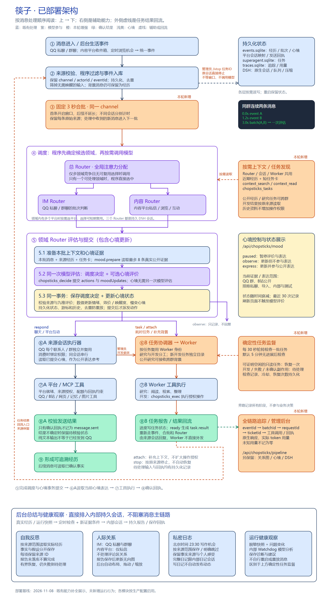
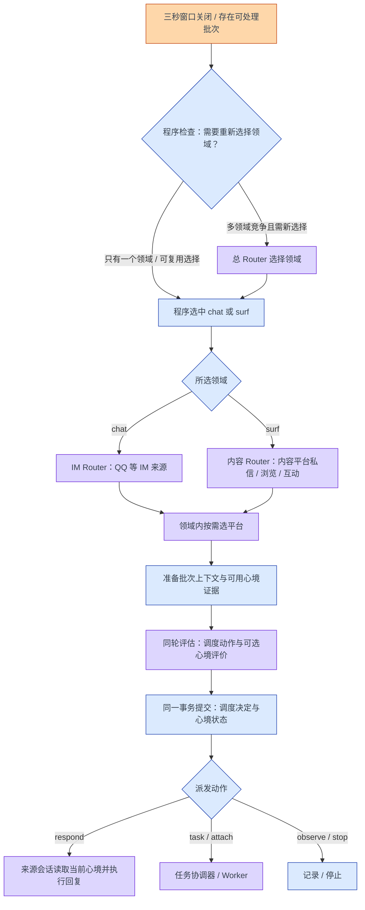

# 筷子已部署架构 · 消息处理顺序

本文对应 **2026-11-08 协调层第一轮已验收部署**，代码基线为 `b18673c`。重点是实际调用顺序；平台适配器按各自配置和登录状态工作。此文档更新不改变服务器运行行为。

[查看矢量图](diagrams/chopsticks-deployed.svg) · [下载可编辑 Excalidraw](diagrams/chopsticks-deployed.excalidraw) · [生成脚本](diagrams/build_architecture.py)

蓝色表示既有处理，紫色表示模型参与，橙色或“本轮增强”标识第一轮落地部分，绿色表示结果与回执。实线按上到下阅读；最外侧橙色虚线是 **Worker 结果重新进入事件链路**。

浅黄色标明主流程内的心境状态处理。**⑤内部依次准备证据、同轮评估、事务提交，随后⑥A读取已提交心境生成表达**。心境没有单独的调度入口或执行会话。后台生活的输入位于①；反思、人际关系、日记和健康观察在图下方列明各自触发方式。

## 一条消息如何走完

| 顺序 | 实际处理 | 代码入口 |
|---|---|---|
| ① 接收 | QQ、内容平台适配器把外部输入转换为统一事件，保留平台、会话、发言人和事件标识。内容浏览机会也可作为事件进入。 | [adapters/qq.mjs](../adapters/qq.mjs)、[host/life-runtime.mjs](../host/life-runtime.mjs) |
| ② 程序处理 | 根据来源、唤醒、潜水和密度规则决定是否调度；原始事件入库、按 ID 去重。无需唤醒的事件可保留为背景，不因此调用模型。 | [host/runtime.mjs](../host/runtime.mjs) 的 `ingest`、[core/events.mjs](../core/events.mjs) |
| ③ 合批 | 生产配置 `routing.batchWindowMs=3000`。按 `channel` 开固定窗口；后来消息不延长截止时间。群里第一句已唤醒后，窗口内不带 @ 的补充也可加入。 | [core/batching.mjs](../core/batching.mjs) |
| ④ 选择领域 / 平台 | 程序计算当前已到期、可处理的候选。只有一个领域直接选择；多领域竞争且没有可复用选择时，总 Router 才参与。领域内多平台同样按需选择。 | [core/router.mjs](../core/router.mjs) 的 `pump`、[core/platforms.mjs](../core/platforms.mjs) |
| ⑤ 评估与提交 | `mood.prepare` 准备本轮可用的公开心境证据，与批次上下文一起交给 IM / 内容 Router。一次 `chopsticks_decide` 返回调度动作与可选心境评价；校验后在同一事务中保存调度决定、执行 `mood.commit` 更新心境，提交后才派发动作。本批最多一个非 `observe` 动作。 | [core/router.mjs](../core/router.mjs)、[host/runtime.mjs](../host/runtime.mjs) 的 `assess` / `decide` |
| ⑥A 会话执行 | `respond` 进入对应持久会话，执行时调用 `mood.expression(channel)`，将符合条件的当前心境加入本轮表达上下文。QQ 每个联系人、每个群各有独立会话；同会话排队，其他会话可以继续。管理员开发要求先由来源会话接收，再用 `chopsticks_develop` 委派。 | [host/platform-sessions.mjs](../host/platform-sessions.mjs)、[host/development.mjs](../host/development.mjs) |
| ⑥B 任务执行 | `task` 可建立后台研究任务；`attach` 把明确引用的任务接入来源背景。Worker 身份按任务复用，新开发 Worker 有独立目录。跨群研究背景不增加操作权限或对外发布目标。 | [tasks/coordinator.mjs](../tasks/coordinator.mjs)、[tasks/dsh-executor.mjs](../tasks/dsh-executor.mjs) |
| ⑦ 工具调用 | 来源会话调用平台 / MCP 工具；研究 Worker 阅读与检索；开发 Worker 通过 `chopsticks_exec` 执行当前授权操作。 | [host/index.mjs](../host/index.mjs)、[host/guard.mjs](../host/guard.mjs)、[host/commands.mjs](../host/commands.mjs) |
| ⑧ 结果确认 | 平台发送必须取得回执才能成为 `message.sent`。Worker 报告进度；完成结果形成 `task.result`，重新入队，由来源会话处理回复。结果不确定时不盲目重放。 | [host/reply-tickets.mjs](../host/reply-tickets.mjs)、[host/delivery-completion.mjs](../host/delivery-completion.mjs)、`runtime` 的 `onResult` |
| ⑨ 形成经历 | 已确认发送、读到的证据、任务报告和追踪信息持久化；下一轮按相应范围取用。 | [core/events.mjs](../core/events.mjs)、[host/state.mjs](../host/state.mjs) |

**三秒是合批窗口，不是回复时限。** 窗口关闭后仍可能等待调度、模型和工具。一次批次评估也不等于模型供应商恰好一次请求：同一 Agent 的工具往返可能产生多次模型响应。

**两个旁路**：管理员在任务原会话明确发送 `/stop 任务ID` 时直接停止，不等待合批和模型；已有的特定程序命令入口也可在普通消息调度前处理。这些都不会把普通消息变成管理员授权。

## Router 的主次关系

总 Router 的职责是“当前优先处理哪个领域”，领域 Router 的职责是“如何处理这个领域里的消息”。它们是三个持久原生 DSH 会话，运行在同一个调度框架内；不是每条消息都要顺序调用三次模型。

浏览活动的 `task` 决定会归入该平台执行会话继续阅读，不会自动替换成一个新的后台 Worker。`attach` / `stop` 的 Router 决定要求原始输入明确给出任务引用；第一轮并未实现任意任务的自动合并。

## 右侧辅助能力接在哪里

| 能力 | 作用位置 | 当前实现 |
|---|---|---|
| 上下文与任务发现 | Router 评估、来源会话和 Worker 按需读取 | `chopsticks_tasks`、`chopsticks_context_search`、`chopsticks_context_read`；短任务卡内联，完整证据按引用展开。公开研究任务可跨群发现；开发及未知分类任务结果按来源限制，自动上下文与显式查询均执行限制。 |
| 任务监督 | 协调器 / Worker 侧 | 每 30 秒轮转检查一批，默认 5 分钟无进展及 5 分钟冷却。只对可证明空闲、没有未确认副作用的研究任务允许一次恢复；开发、失败、阻塞和不确定执行进入待处理记录。健康状态不触发周期性模型调用。 |
| 追踪 | 各阶段的旁路记录 | `eventId → batchId → requestId → ticketId` 关联决策、实际模型响应、工具与回执。Worker 排队的新输入只有实际消费后才切换追踪归属。原生用量缺失时显示未知。 |
| 持久化 | 各层读写 | `events.sqlite` 保存事件、批次、会话映射、发送与宿主状态；`tasks/superagent.sqlite` 保存任务、输入和效果记录；`traces.sqlite` 保存追踪与用量；DSH 自身保存会话、队列和压缩历史。 |

独立会话、经历检索范围和操作权限是不同概念。当前分层模式下，通用历史上下文仍有**平台内私聊共享**策略；新增 `context_*` 工具读取私聊时按当前来源限制。公开经历可跨群，任务控制与开发授权另行校验。具体范围见 [core/platforms.mjs](../core/platforms.mjs)、[core/events.mjs](../core/events.mjs) 和 [host/context-service.mjs](../host/context-service.mjs)。

## 主流程中的心境处理细节

心境由 [host/mood.mjs](../host/mood.mjs) 接入，数值演化使用 [vendor/cerebrum/affect.mjs](../vendor/cerebrum/affect.mjs)。这是**模拟的表达状态**；当前没有把上游库全部能力接入规划、权限或工具执行。

| 图中节点 | 实际行为 |
|---|---|
| 5.1 准备证据 | 从事件日志读取真实公开经历。当前代码范围是 QQ 群 `g:*` 和 `bili:public`，不泛指所有平台的公开内容。接纳收到的消息、带确认消息 ID 的发送，以及明确标为已经历的任务结果；排除私聊、内部、迁移、导入和合成事件。公开轮次可以推进积压证据，定时机会本身不算情绪证据。 |
| 5.2 同轮评价 | 领域 Router 评估批次时，`mood.prepare` 按有界游标提供最多 8 条证据；模型在同一次 `chopsticks_decide` 中可选提交 `moodUpdatesJson`。九个评价维度为相关性、一致性、新颖度、确定性、主体性、控制感、规范、紧迫性、影响程度。没有依据可以省略，不独立增加一轮心境 LLM 评估。 |
| 5.3 事务提交 | 程序验证完整维度、数值范围和精确来源 ID；与 Router 决策一起事务提交，防止重复评价。情绪类别与强度、效价 / 唤醒度、慢变心境由数值系统演化；随时间回归基线。状态、来源游标和最近 30 次更新记录保存在事件数据库的 `cerebrum_*` 表。 |
| ⑥A 会话表达 | 来源会话执行时读取 `mood.expression(channel)`。仅在 `express` 模式、已有有效评价且为上述公开来源时，附加简短情绪标签与强度；私聊不注入。它不决定是否回复，不改变任务授权、工具权限或配额。 |

管理页 [`/api/chopsticks/mood`](http://192.168.5.234:3080/api/chopsticks/mood) 展示情绪、效价 / 唤醒度、慢变心境、来源及更新历史，可切换 `paused`（暂停评价与表达）、`observe`（更新但不参与表达）、`express`（更新并参与公开表达）。读取状态时按时间计算衰减；刷新页面不会制造新经历或调用模型。功能总开关为 `cerebrum.enabled`。

## 后台生活、日记、反思和人际关系

这些模块会影响后续表达或保存总结，**不属于每条消息从①到⑨的固定串行步骤**：

- **后台生活 / 平台运行**：浏览机会和收件箱轮询通过平台适配器接入①；受配置、平台就绪状态和既有行动规则约束。实际工具结果与确认发送才形成相应经历。外发继续使用来源授权、共享配额账本、平台状态检查与发送回执；未知结果不盲目重发。见 [host/life-runtime.mjs](../host/life-runtime.mjs)、[host/social-policy.mjs](../host/social-policy.mjs)。
- **自我反思**：后台选取对应范围的实际经历，排入内部进化会话，分别保存带来源的事实与假设。报告未落库不算完成；仅有一次间隔恢复机会，仍未完成则标记待处理。见 [host/evolution.mjs](../host/evolution.mjs)。
- **人际关系**：IM 当前纳入 QQ 私聊和群聊；内容平台只纳入私信，不处理评论区关系。报告保存后更新可溯源的无向关系图，区分观察事实与假设；管理后台提供自动布局、拖动和缩放。见 [host/relationship-graph.mjs](../host/relationship-graph.mjs)。
- **日记**：北京时间 23:30 提供写作机会，内部日记会话可保存或明确跳过，按来源范围持久化。完整日记仅供内部日记会话读取，不自动变为平台消息；公开动态属于另外一次外发选择。见 [host/diary.mjs](../host/diary.mjs)。
- **运行健康 Watchdog**：既有进化模块中的健康观察会话，与本轮新增的**确定性任务监督**是两条不同机制。不能把前者的模型观察画成后者的每 30 秒检查。

内部进化 / 日记任务由后台调度器直接排入对应会话，不必绕过一轮普通消息 Router 才能开始。

## 入口、目录和维护方式

- 管理后台：[`/api/chopsticks/pipeline`](http://192.168.5.234:3080/api/chopsticks/pipeline)；关系图：[`/api/chopsticks`](http://192.168.5.234:3080/api/chopsticks)；心境：[`/api/chopsticks/mood`](http://192.168.5.234:3080/api/chopsticks/mood)。沿用 DSH 登录鉴权。
- 代码：`/opt/chopsticks`；私有配置 / 角色 / 状态：`/var/lib/chopsticks`；常用开发工作区：`/root/workspace/dsh`。
- 本轮不依赖 SessionCross；跨机器带记忆调度插件属于另外的后续方向。
- 图源、SVG 和 PNG 同时保留；修改 [build_architecture.py](diagrams/build_architecture.py) 后运行生成脚本，并重新渲染、检查 PNG。此次仅更新架构文档，不增加新的提示词、运行规则或部署改动。
