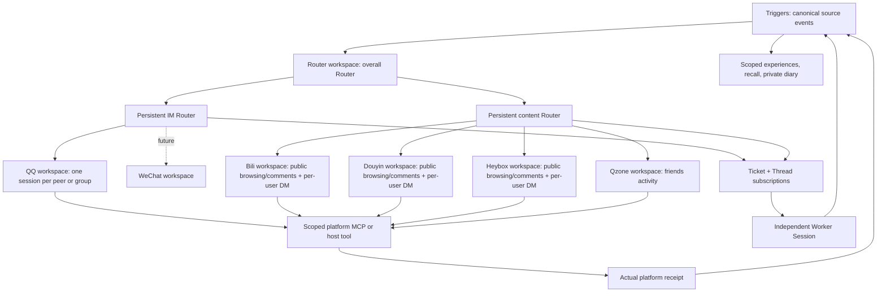
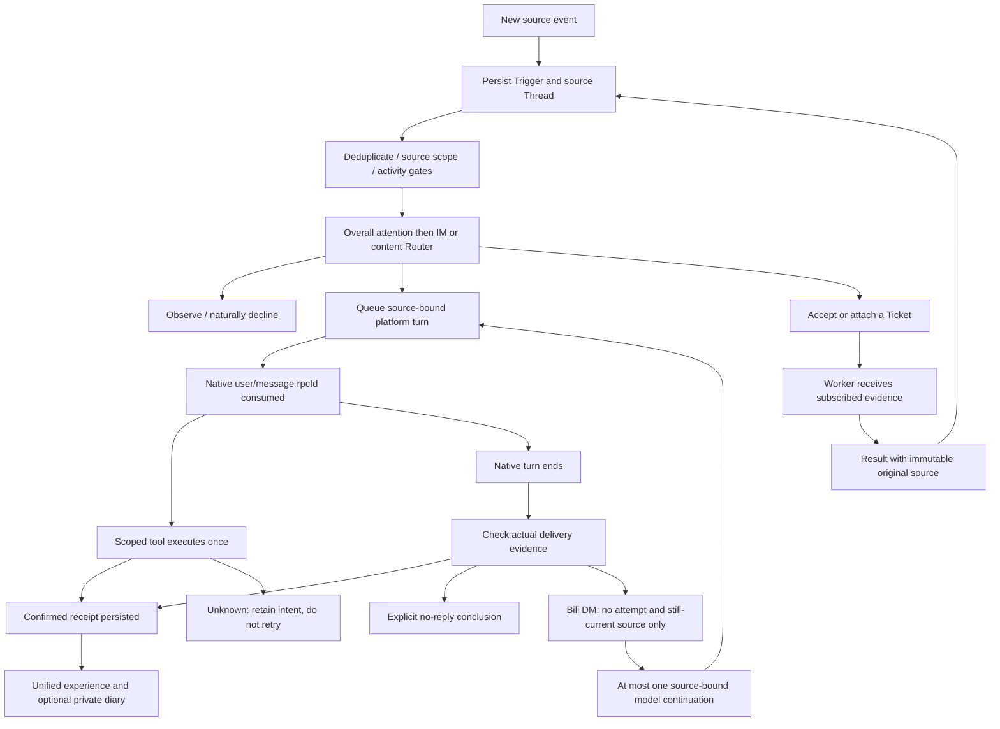

# 筷子 v0.1 design

Approved direction: independent continuously online fish; global Router + isolated workers + persisted shared experiences + watchdog. SessionCross is optional future cross-machine infrastructure, not a runtime dependency. QQ group experiences and confirmed self messages are globally known across groups. Do not expand private/operator disclosure by inference.

Sources normalize QQ inbound, successful outgoing receipts, Bili observations, task results and timer ticks to durable events. Program gates deduplicate and apply source/allowlist/rate constraints; model assessor decides observe/respond/task for actionable events. Router is one logical decision owner backed by three persistent native DSH conversations (overall, IM, content), with DSH compaction. Context comes from canonical event journal and task references, with recent confirmed self messages given priority. Worker contexts remain separate but draw on shared group experience. New inbound interrupts neither the global service nor unrelated workers.

Runtime is a DSH bundle at /opt/chopsticks. Host owns persisted event store, serialized semantic routing, scoped tools, MCP child and work sessions. QQ transport connects to existing authenticated SnowLuma gateway; it does not distribute that runtime. Existing fish histories and role memory are retained. New layout-v2 execution sessions use stable platform workspace directories; old shared transcripts are not copied into per-contact conversations. Root project is not a renamed copy of SurfCore.

Keep: QQ group/private handling, configured allowlist/admin identity, anti-spam/fish guard, text/images/forwarding where adapters support them, role/persona and existing full memories, Bili read/search/subtitles/frames and guarded publishing, durable delegated tasks. Drop: desktop pets, voice, old web console/update machinery, unused platform extensions. A compact health/task view and documented config replace the broad old console.

Evaluation must cover real model seeing confirmed message from group A when drafting in group B; duplicate inputs, send uncertainty, cancellation, restart, busy worker and fresh context refresh. No synthetic public messages. Stop old production owner before enabling new owner. Rollback restores old profile/env; additive state remains for audit.

Runtime inputs and credentials live outside repository. Imported memory retains provenance and counts. No unrelated local knowledge import. Development execution is restricted to authenticated administrator-origin work; background content work has read tools. Autonomous behavior requires a configured standing rule, not a retrieved text instruction.

## Native workspace layout (2026-11-05)

The native session key is distinct from its source Thread and task Ticket. Every incoming event has a stable Trigger identity. Private/group conversations provide stable source Threads; a content object can provide its own Thread while public browsing still advances one shared platform-native conversation. Router decisions only contain validated IDs and action types. Private Router history is never forwarded as free-form actor instructions.

The existing SuperAgent Engine owns Tickets, assignments, subscriptions and the effect journal. Explicit accept/attach/ignore/stop decisions suppress automatic subscription fanout for that Trigger. Attach and stop require an explicit source reference and exact source/character scope. Task results retain trusted original delivery coordinates but use a new delivery-event identity; they return through Router before an external reply.

Normal authenticated HTTP is preferred. Douyin uses its existing logged-in browser for UI-dependent writes, validating request target/account before release and matching real platform receipts. Desktop control remains optional and is not injected as an instruction to use it. Heybox public interactions and personal DM use a narrow Node adapter with normal website-issued session tokens. Polling baselines only successful reads; paginated catch-up retains its old watermark and a durable cursor until drained.

An explicitly authorized administrator may initiate a Douyin or Heybox DM through `direct_message` on the existing private operator socket. It binds the expected account, peer, exact text and immutable command ID; Douyin additionally requires its verified profile and conversation identifiers. It uses the same adapter, quotas, durable send record and confirmed-event journal as ordinary replies. It does not fabricate an incoming message or a reply ticket, and is unavailable on the actor socket. Equivalent uncertain effects cannot be replayed by changing the command label. Normal model replies continue to require their source-bound tickets.

Native workspaces live beneath the private state root's `workspaces/` directory. New Worker sessions share `workspaces/tasks`; existing native histories retain their original cwd because DSH rc2 has no supported header-cwd relocation API. Queued legacy platform jobs are re-bound to the new per-conversation session; started/uncertain work is never replayed. Only demonstrably unused sessions are archived through native activity checks.

## Social response policy (2026-11-07)

Every content platform has its own rolling one-hour limit: comments and replies share a limit of 10, and direct messages have a separate limit of 30. QQ, WeChat, and other IM channels receive no new numeric limit and retain their existing selective routing. Any social message or mention may be observed without replying when context makes a response repetitive or unhelpful. These limits are ceilings, not activity targets; alternate MCP, browser, and desktop routes must not bypass them.

The host reserves budget immediately before an actual write through one SQLite ledger shared by its platform adapters. Confirmed and unknown outcomes retain their reservations; only explicit, proven not-sent outcomes may release them. The ledger and stable intent identities survive restart, and uncertain intents must not be blindly retried. Existing daily caps and platform safety gates remain in force. Accounting begins when this ledger is enabled; earlier outbound activity is not backfilled.
